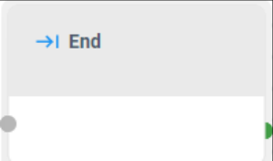

<Info>
Content version: **Voca CIC Flow Designer User's Manual, Version 12.2**
</Info>

The ‘End’ building block represents the end point of the flow.

#### To use the End building block

1. On the left pane, under **Call-Flow Logic**, click **End**; the following End building block appears:

   
