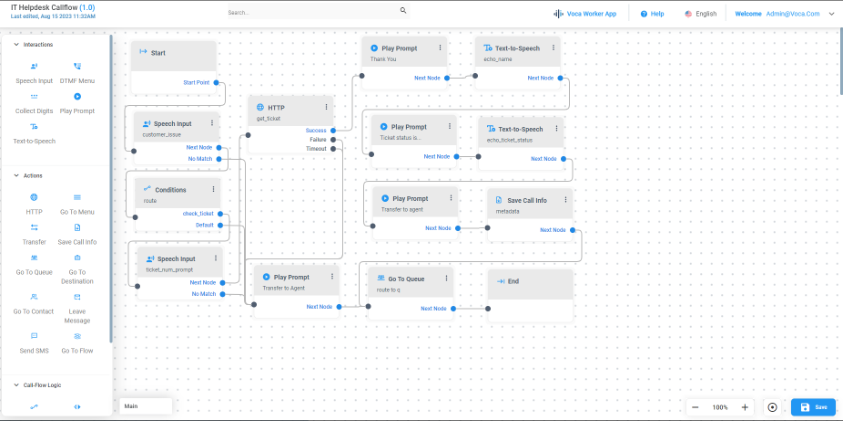

<Info>
Content version: **Voca CIC Flow Designer User's Manual, Version 12.2**
</Info>

Use the following building blocks to create the call flow logic:

- [Interactions](/flow-designer-manual/building-blocks/fd-06-building-blocks/fd-06-1-interactions)

- [Actions](/flow-designer-manual/building-blocks/fd-06-building-blocks/fd-06-2-actions)

- [Call-Flow Logic](/flow-designer-manual/building-blocks/fd-06-building-blocks/fd-06-3-call-flow-logic)

You can connect the building blocks by placing the cursor on the output leg, and then dragging the connector to the appropriate actions.

#### To add a building block to the flow designer

1. From the left bar, click the appropriate building block; the selected building block appears on the flow designer workspace.

2. Drag the building block to the desired position on the flow designer workspace.

3. Drag the relevant nodes to each appropriate building block, to connect the flow.

   
