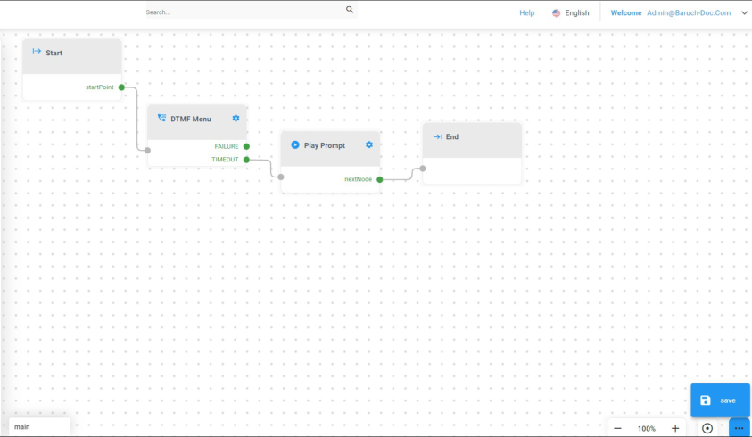
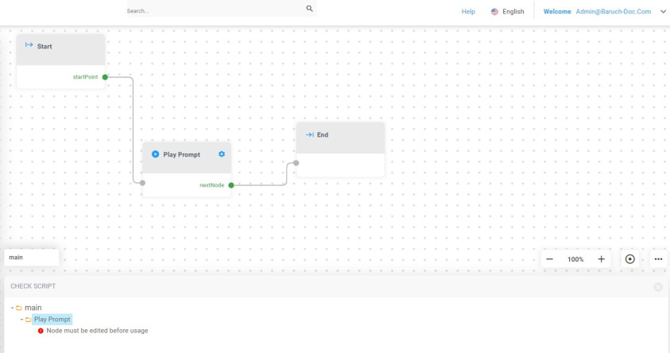

<Info>
Content version: **Voca CIC Flow Designer User's Manual, Version 12.2**
</Info>

The procedure below describes how to save a script.

#### To save a script

1. On the lower-right part of the main flow designer workspace, click the **ellipsis icon** (three dots), and then click **Save**.

   

   A CHECK SCRIPT validation window appears on the lower part of the screen to display script errors (if any). This feature allows you to easily locate errors and fix them.

   
