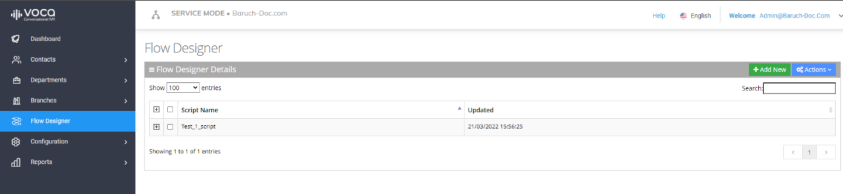
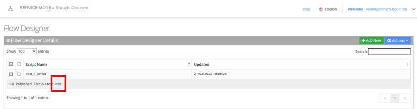
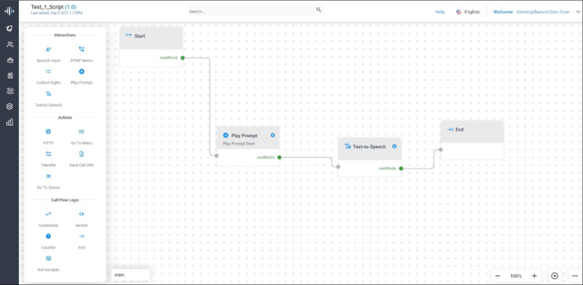
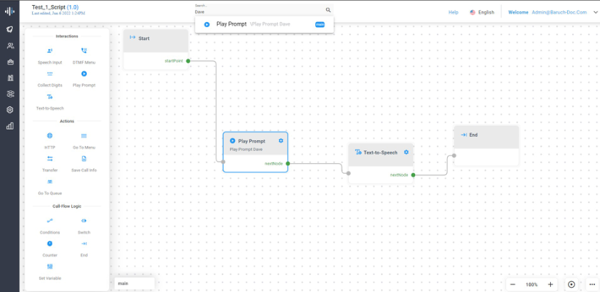

<Info>
Content version: **Voca CIC Flow Designer User's Manual, Version 12.2**
</Info>

The procedure below describes how to use the Search engine.

#### To use the Search engine

1. From the Navigation pane, click **Flow Designer**; the Flow Designer page opens:

   

2. Select the script you want to edit, by clicking the corresponding plus box; the **edit** link appears under the selected script:

   

3. Click **edit**; the main flow designer workspace appears:

   

4. In the 'Search' field, enter the search string you are looking for, and then press **Enter**; the building block containing the search string is highlighted. In the example below, the building block containing the search string "Dave", is highlighted.

   
